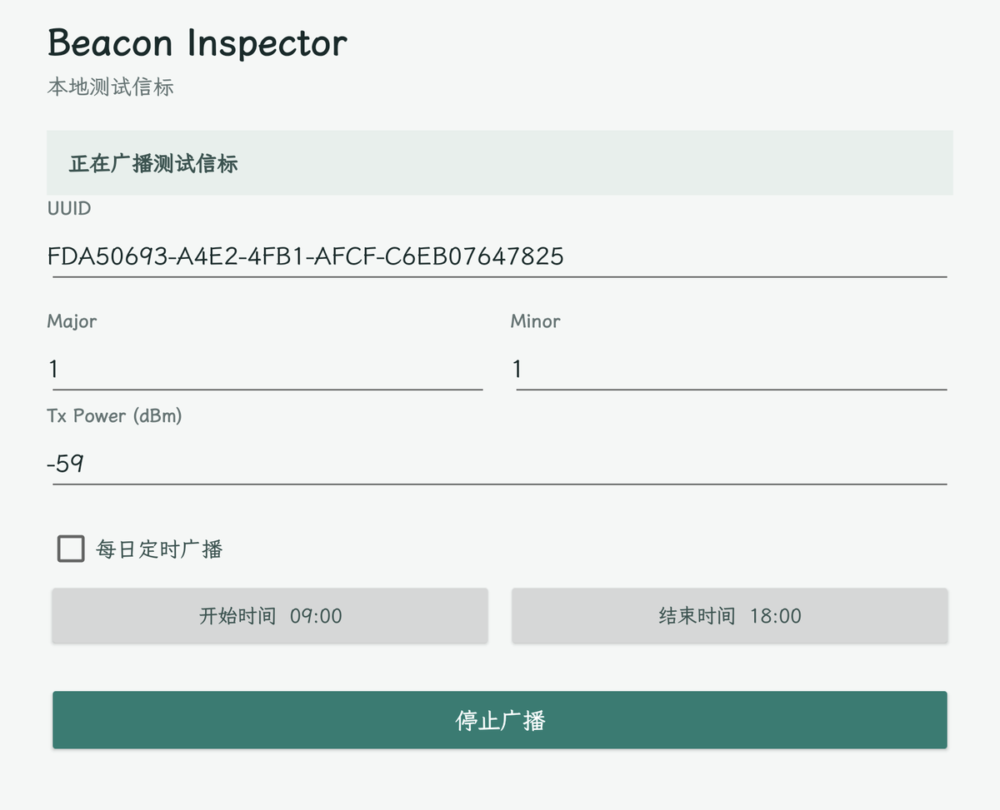

# BLE iBeacon 测试工具


本仓库包含 Windows PowerShell 和 Android 两种 iBeacon 测试工具，用于在自有设备或已获授权的环境中验证 BLE 广播链路。

## 项目内容

```text
.
├── Start-BrightBeacon.ps1
├── android/
│   ├── app/
│   ├── gradlew
│   └── README.md
├── assets/
└── 相关文档/
```

Windows 脚本保留固定参数的基础广播测试流程。Android 应用提供可编辑的 iBeacon 参数、启动时自动广播和每日时段计划。Android 使用通用示例 UUID 和独立的 Major、Minor 测试值。

## Android 应用

[下载最新 Android 安装包](https://github.com/FigureQAQ/wqtsg-pc-ble-signin/releases/latest)

应用首次默认使用以下本地测试参数：

| 参数 | 默认值 |
| --- | --- |
| UUID | `FDA50693-A4E2-4FB1-AFCF-C6EB07647825` |
| Major | `1` |
| Minor | `1` |
| Tx Power | `-59 dBm` |

UUID、Major、Minor 和 Tx Power 编辑为有效值后会自动保存，重新打开应用会恢复这些值。手动广播时，停止后点“开始广播”即可使用已保存的参数。未启用每日计划时，打开应用会自动开始广播，离开应用后广播暂停。

开启“每日定时广播”后，可设置每日开始和结束时间。默认时间为 09:00 至 18:00，支持跨午夜时段。计划在后台运行，并在设备重启后恢复。关闭每日计划后，打开应用会直接广播。

### Android 真机截图



### 构建和安装

1. 用 Android Studio 打开 `android/` 目录，并安装 Android SDK Platform 35。
2. 连接支持 BLE 广播的 Android 设备，运行 `app` 配置。
3. 也可以在该目录执行以下命令构建 Debug APK：

```powershell
.\gradlew.bat assembleDebug
```

APK 输出到 `android/app/build/outputs/apk/debug/app-debug.apk`。

Android 12 及以上需要允许“附近设备”权限。每日计划需要“闹钟和提醒”精确闹钟访问；Android 13 及以上还需要通知权限。设备需支持 BLE 广播。

## Windows 脚本

`Start-BrightBeacon.ps1` 会构造 iBeacon 广播负载，初始化 Windows 蓝牙广播对象并开始广播。按回车后脚本停止广播。

脚本内置参数如下：

| 参数 | 当前值 | 说明 |
| --- | --- | --- |
| `UUID` | `FDA50693-A4E2-4FB1-AFCF-C6EB07647825` | 脚本广播使用的 UUID |
| `Major` | `10199` | 主编号 |
| `Minor` | `42474` | 次编号 |
| `Tx Power` | `0xBF` | 发射功率校准值 |
| `CompanyId` | `0x004C` | iBeacon Manufacturer ID |
| `Payload Length` | `23` 字节 | Manufacturer Data 长度 |

在 PowerShell 中运行：

```powershell
powershell -ExecutionPolicy Bypass -File ".\Start-BrightBeacon.ps1"
```

有关操作方式和脚本修改过程，参阅 `相关文档/BrightBeacon_操作文档.md` 与 `相关文档/Start-BrightBeacon-修改过程总结.md`。

## 使用范围

仅用于已获授权的测试、研究和验证。请勿用于绕过签到、考勤、门禁、定位或任何未经授权的用途。
