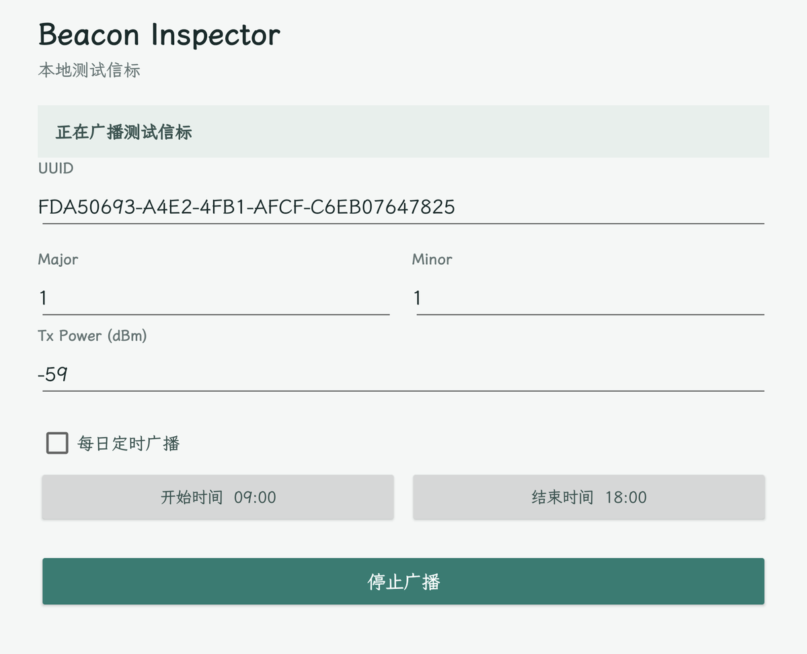

# Beacon Inspector

一个用于授权测试环境的 Android BLE 测试信标。未开启每日计划时，应用获得附近设备权限后会在打开时自动广播。首次启动使用通用示例 UUID `FDA50693-A4E2-4FB1-AFCF-C6EB07647825`，Major 和 Minor 均为 `1`，Tx Power 为 `-59 dBm`。UUID、Major、Minor 和 Tx Power 编辑为有效值后会自动保存，重新打开应用会恢复这些值。手动广播时，停止后点“开始广播”即可使用已保存的参数。

开启“每日定时广播”后，可设置每天的开始和结束时间，默认时段为 09:00 至 18:00，支持跨午夜时段。计划会在后台运行并在设备重启后恢复。Android 12 及以上需要允许精确闹钟访问，Android 13 及以上需要允许通知权限。每日计划默认关闭。

## Android 真机截图

## 在 Android Studio 中运行

1. 使用 Android Studio 打开此目录。
2. 安装 Android SDK Platform 35。
3. 等待 Gradle 同步完成后，在 Android 6.0 及以上、支持 BLE 的设备上运行。

设备需要支持 BLE 广播。信标采用 Apple Manufacturer ID 的 iBeacon 数据格式，仅用于本地测试。
